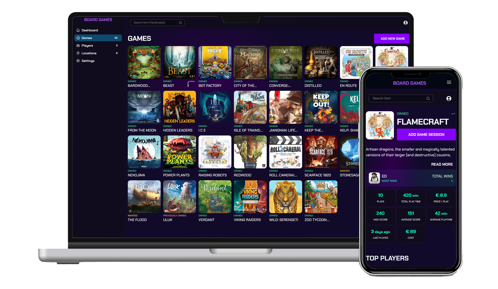
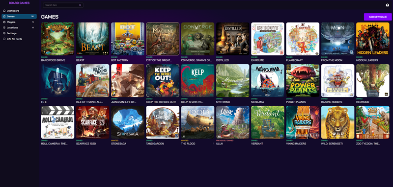
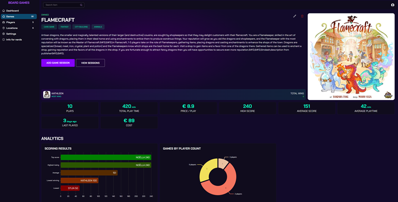
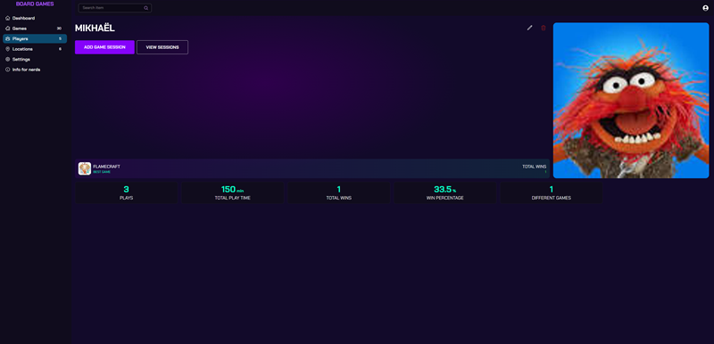
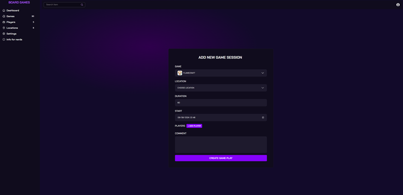

# BoardGameTracker

<p align="center">
  
</p>

<p align="center">
  <strong>A self-hosted board game statistics tracker for analyzing your collection and gaming sessions</strong>
</p>

<p align="center">
  <a href="https://github.com/mregni/BoardGameTracker/releases">
    
  </a>
  <a href="https://github.com/mregni/BoardGameTracker/actions/workflows/publish-container.yml">
    
  </a>
  <a href="https://github.com/mregni/BoardGameTracker/actions/workflows/security.yml">
    
  </a>
  <a href="https://sonarcloud.io/summary/new_code?id=mregni_BoardGameTracker">
    
  </a>
  <a href="https://sonarcloud.io/component_measures?id=mregni_BoardGameTracker&metric=security_review_rating&view=list">
    
  </a>
  <a href="https://sonarcloud.io/summary/new_code?id=mregni_BoardGameTracker">
    
  </a>
  <a href="https://hub.docker.com/r/uping/boardgametracker">
    
  </a>
  <a href="https://hub.docker.com/r/uping/boardgametracker">
    
  </a>
  <a href="https://github.com/mregni/BoardGameTracker/blob/master/LICENSE">
    
  </a>
</p>

---

## Overview

BoardGameTracker is a self-hosted application designed for board game enthusiasts who want to:
- Track spending on their collection
- Analyze game statistics and identify favorites
- Monitor player performance and win rates
- Visualize gaming trends over time

**BoardGameGeek (BGG) integration** works with a personal BGG API key: request one at [boardgamegeek.com/applications](https://boardgamegeek.com/applications) and paste it under *Settings → Integrations* (or set `BGG_API_KEY`). It unlocks single-game import, collection import and expansion lookup.

> ⚠️ **Note**: This project is under active development. Breaking changes may occur between releases.

---

## Installation

> **Note:** the documentation follows the `beta` image. Until the next stable release after v0.2.181, `latest` lacks some of the features described here; use `uping/boardgametracker:beta` to get them.

### Prerequisites
- Docker with Docker Compose 2.24 or newer for the downloadable `docker-compose.yml` (older versions, such as some NAS container managers, reject its optional `.env` block; use the compose file on the [Docker](https://mregni.github.io/BoardGameTracker/getting-started/docker/) docs page instead)
- PostgreSQL with the `vector` extension (the compose file runs `pgvector/pgvector:pg16`; plain `postgres:16` does not work)

### Quick start with Docker Compose

1. Download the compose file (it also contains the optional rules assistant, off until you enable it) and the example environment file:

```sh
wget https://raw.githubusercontent.com/mregni/BoardGameTracker/refs/heads/master/docker-compose.yml
wget -O .env https://raw.githubusercontent.com/mregni/BoardGameTracker/refs/heads/master/.env.example
```

2. Fill in `.env`:
   - `DB_PASSWORD`: a password for the database
   - `JWT_SECRET` and `DATA_PROTECTION_KEY`: each its own random value of at least 32 characters, from `openssl rand -base64 48`. The application does not start while `JWT_SECRET` is empty or still starts with `CHANGEME`. Keep `DATA_PROTECTION_KEY` safe: losing or changing it means entering the stored secrets (OIDC client secret, API keys) again
   - `TZ`: your timezone

3. Start the containers:
```sh
docker compose up -d
```

To also run the rules assistant, set `RAG_ENABLED=true` in `.env` and start the stack with the `rag` profile: `docker compose --profile rag up -d`.

4. Open `http://localhost:5444` and sign in as `admin`, with the `ADMIN_PASSWORD` you set or `admin` when it is empty. Change the password after the first login.

The [documentation](https://mregni.github.io/BoardGameTracker/getting-started/quick-start/) covers the full compose file, `docker run`, upgrading and reverse proxies.

### Docker run

With an existing PostgreSQL server that has the `vector` extension installed. Fill in `JWT_SECRET` and `DATA_PROTECTION_KEY` with the output of `openssl rand -base64 48`, each its own value:

```sh
docker run -d \
  --name boardgametracker \
  --restart unless-stopped \
  -e DB_HOST=<your-postgres-host> \
  -e DB_USER=dbuser \
  -e DB_PASSWORD=CHANGEME \
  -e DB_NAME=boardgametracker \
  -e DB_PORT=5432 \
  -e JWT_SECRET= \
  -e DATA_PROTECTION_KEY= \
  -e TZ=UTC \
  -p 5444:5444 \
  -v ./images:/app/images \
  -v ./logs:/app/logs \
  -v ./manuals:/app/manuals \
  uping/boardgametracker:latest
```

---

## Configuration

### Environment variables

| Variable          | Default            | Required | Description |
|-------------------|--------------------|:--------:|-------------|
| `DB_HOST`         | -                  | ✅       | PostgreSQL hostname |
| `DB_PORT`         | `5432`             | ❌       | PostgreSQL port |
| `DB_USER`         | -                  | ✅       | PostgreSQL username |
| `DB_PASSWORD`     | -                  | ✅       | PostgreSQL password |
| `DB_NAME`         | `boardgametracker` | ❌       | PostgreSQL database name |
| `JWT_SECRET`      | -                  | ✅       | Signing key for login tokens, at least 32 characters; values starting with `CHANGEME` are refused. Not needed when `AUTH_ENABLED=false` |
| `DATA_PROTECTION_KEY` | -              | ❌       | Strongly recommended, at least 32 characters. Encrypts the stored data protection keys; a warning is logged while it is missing |
| `AUTH_ENABLED`    | `true`             | ❌       | Set to `false` to run without login (anyone on the network gets full access) |
| `ADMIN_PASSWORD`  | -                  | ❌       | Password (at least 8 characters) of the `admin` account when no account exists yet; `admin` when empty |
| `TZ`              | `UTC`              | ❌       | Timezone (e.g., `America/New_York`, `Asia/Tokyo`) |
| `STATISTICS_ENABLED` | `false`         | ❌       | Send error reports, a sample of performance traces and scrubbed browser session replays to Sentry |
| `PUID` / `PGID`   | `1654`             | ❌       | User and group that own the mounted `images`, `logs` and `manuals` folders |

Date format, time format, currency and language are set in the application under *Settings*. The full list, including email, reverse-proxy and rules-assistant settings, is in the [documentation](https://mregni.github.io/BoardGameTracker/getting-started/environment-variables/).

---

## Screenshots

<details>
<summary>Click to view screenshots</summary>

### Game Collection


### Game Details & Statistics


### Player Statistics


### Session Recording


</details>

---

## Technology Stack

### Backend
- .NET 10
- Entity Framework Core
- PostgreSQL
- Serilog for logging

### Frontend
- React 19
- TypeScript
- TanStack Router & Query
- Tailwind CSS
- Radix UI
- Vite

### Infrastructure
- Docker & Docker Compose
- GitHub Actions CI/CD
- SonarCloud code quality analysis

---

## Development

### Building from Source

1. Clone the repository:
```bash
git clone https://github.com/mregni/BoardGameTracker.git
cd BoardGameTracker
```

2. Run with Docker Compose:
```bash
docker compose -f docker-compose.build.yml up --build
```

### Running Tests

**Backend:**
```bash
dotnet test
```

The integration tests start a PostgreSQL container, so Docker must be running.

**Frontend:**
```bash
cd boardgametracker.client
pnpm test:run
```

---

## Contributing

Contributions are welcome! [CONTRIBUTING.md](CONTRIBUTING.md) explains the local setup, the checks that run on every pull request and the conventions used in the code base. Security issues go through [SECURITY.md](SECURITY.md).

1. Fork the repository
2. Create your feature branch (`git checkout -b feature/AmazingFeature`)
3. Commit your changes (`git commit -m 'feat: add some AmazingFeature'`)
4. Push to the branch (`git push origin feature/AmazingFeature`)
5. Open a Pull Request


---

## Support

If you encounter any issues or have questions:
- Open an [issue](https://github.com/mregni/BoardGameTracker/issues)
- Check existing [discussions](https://github.com/mregni/BoardGameTracker/discussions)

---

## Acknowledgments

- Tested with [BrowserStack](https://www.browserstack.com/)
- Translations managed with [Crowdin](https://crowdin.com/)
- Game data from [BoardGameGeek](https://boardgamegeek.com/)
