import { Aside } from '@astrojs/starlight/components';

The sections below follow the order of the application's sidebar. Everything that changes data needs the *User* or *Admin* role; see [Authentication and users](/BoardGameTracker/getting-started/authentication/).

## Dashboard

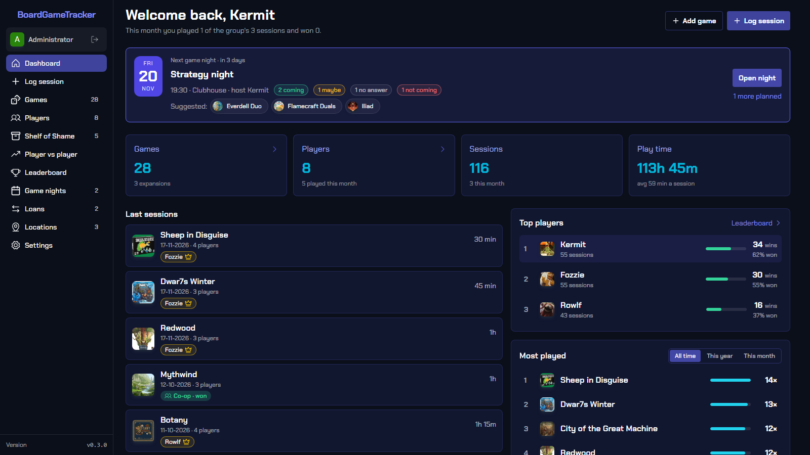

The dashboard shows your collection at a glance: number of games, players and sessions, collection value and average cost (owned games and owned expansions, with a bar that splits the amount between both), total and average play time, expansions owned, the most played games, recent activity, recently added games and a chart of your games by state. When your account is linked to a player you also get a personal welcome card with your own statistics.

## Log session

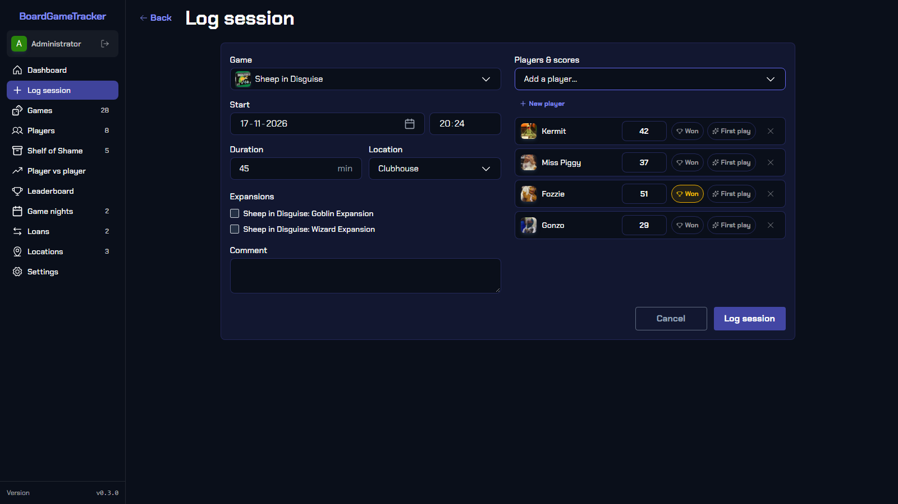

*Log session* records a play. The form works the same on a phone and on a desktop:

- **Game** — open the list to see your *Recently played* games above *All games*, or start typing to search the whole collection.
- **Start**, **Duration** and **Location** are filled in for you: the duration is the game's maximum play time, the start is now minus that duration and a new session gets the location of your last session. The location is optional and the start can't be in the future. The time follows your time format setting (12 or 24 hours); type the hours and minutes or change them with the arrow keys.
- **Players** — with an empty search the three players you play with most are suggested; type to search everyone, or use *Add player* below the list to create someone on the spot. Each player gets a card with a score, a **Won** toggle and a **First play** toggle, and × removes them again.

For scoring games the highest score is marked as the winner (ties give several winners) until you change *Won* yourself. Leave the score empty when you do not know it; negative scores are allowed. Expansions used in the session can be ticked when the game has any.

For a game that can be played co-op, switch on *Played co-op*: the session then records a *Team result* (*We won* / *We lost*) and an optional *Team score* instead of a winner per player.

Sessions can be edited and deleted from a game's, a player's or a location's session list.

## Games

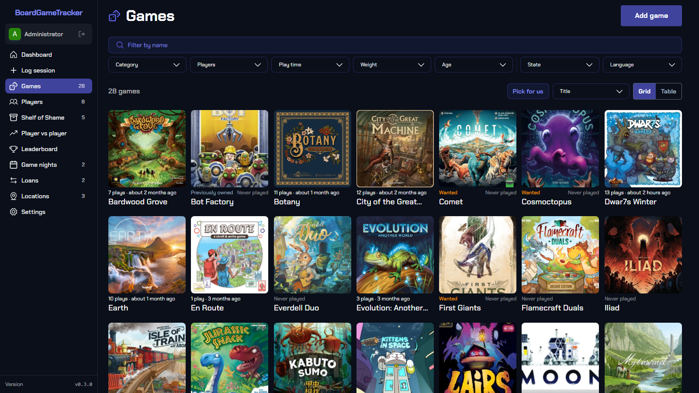

Your collection. Games can be added in three ways:

- **BoardGameGeek import** — enter the BGG id, pick the state (owned, wanted, ...) and the price; title, image, players, play time, categories and mechanics are filled in. When the id belongs to an expansion, it is added to its base game instead; a base game that is not in the collection yet is imported first, with the same state. Needs a [BGG API key](/BoardGameTracker/getting-started/environment-variables/), entered under *Settings → Integrations*.
- **BGG collection import** — enter a BGG username and tick the games you want; games that are already in the collection are skipped. Expansions are listed under their base game. Ticking an expansion ticks its base game too when that game is not in the collection yet, and it is imported with it.
- **CSV import** — on the same page, upload a CSV file instead of entering a username: a collection export from BoardGameGeek works as is, and a file of your own needs at least an `objectid` column with the BGG id. Also read are `objectname`, `itemtype` (`standalone` or `expansion`), `basegame` (BGG id of the base game, to link an expansion yourself), the state flags `own`, `prevowned`, `fortrade`, `want`, `wanttobuy`, `wishlist` and `preordered` (without them every row is owned), `pricepaid` and `acquisitiondate` (`yyyy-mm-dd`). Commas and semicolons both work as separator. Expansions are linked to their base game on BoardGameGeek; rows that cannot be read are listed with their line number and the reason. The review screen works as for a BGG collection, and owned games land in *Needs a place* on the storage page. At most 2000 rows and 1 MB per file.
- **Manual** — fill in the form yourself. Player count and play time are ranges, so enter both ends or leave both empty.

Each game has a state (*owned*, *wanted*, *for trade*, *previously owned*, *sold*) and a **scoring** switch. Turn scoring off for games without points: sessions then only record who won, and the score charts stay hidden. For co-operative games switch on *Can be played co-op*, and optionally *New sessions start as co-op*; a co-op session records a team result instead of a winner per player.

The game page shows statistics (plays, total play time, price per play, best score, top players), the last sessions, expansions, the uploaded rulebooks (*Manuals*) and, once the rules assistant is enabled, an *Ask the manual* button. In the *Table view* of Games you can edit language, state, price and storage location inline, and tick several games to move them to a storage location at once.

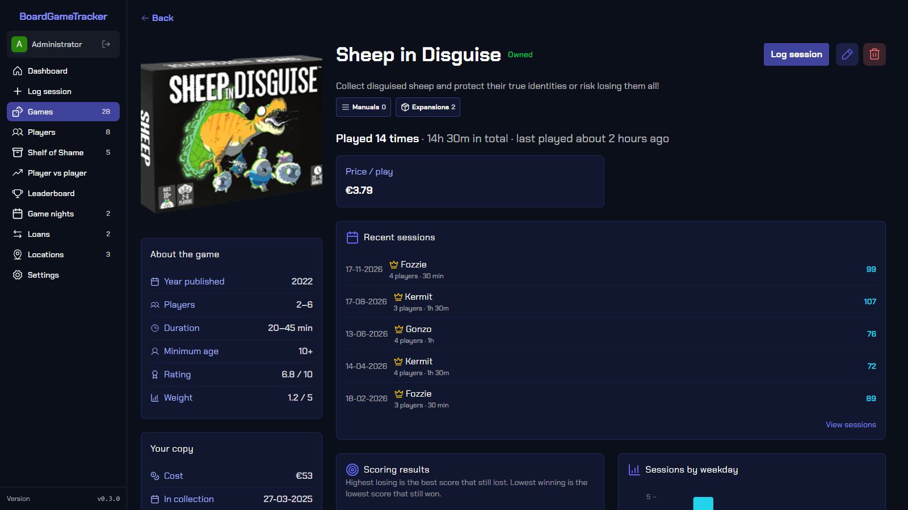

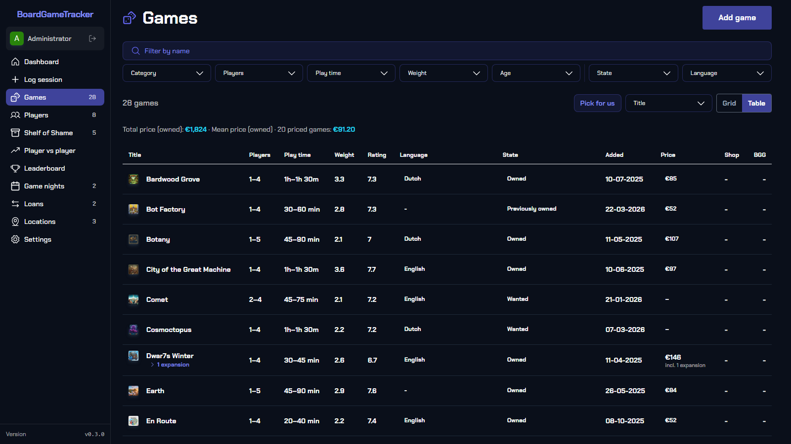

Expansions have their own state, price and date added, and those picked from BoardGameGeek get their own cover. Edit them in the *Expansions* dialog of the game page, or in the table view: a game with expansions is one row whose price is the base game and its owned expansions together; open it to edit the base game and each expansion on their own row. The price per play and the Shelf of Shame keep using the price of the base game.

The *Storage* filter shows the games stored in a place and everything below it, or *No storage location* for owned games and games for trade without a place. In the card view a *Type* filter shows base games, expansions or both; it starts on base games and switches to both when you pick a storage location. An expansion card opens a quick view where you change its state, price and storage location.

<Aside type="tip">
Ratings (0-10), weight (0-5) and, for a *sold* game, the price it was sold for can be edited on the game's update page.
</Aside>

### Price tracking

With a [changedetection.io](https://changedetection.io) instance connected under *Settings → Integrations*, BoardGameTracker shows the current shop price and stock of a game. On a game page, *Track price* asks for the shop page of the game, creates a watch on changedetection.io and links it; a game that already has a watch can be linked by entering its watch id on the game's update page. The game page then shows the current price with a refresh button.

The *Table view* adds a *Current price* column, an *In stock only* filter and a *Refresh prices* button that asks changedetection.io to check every tracked shop again. Switching a game to *owned* in the table fills in its price from the current shop price when no price was entered yet. Only public web shops can be tracked; addresses on your local network are refused.

## Players

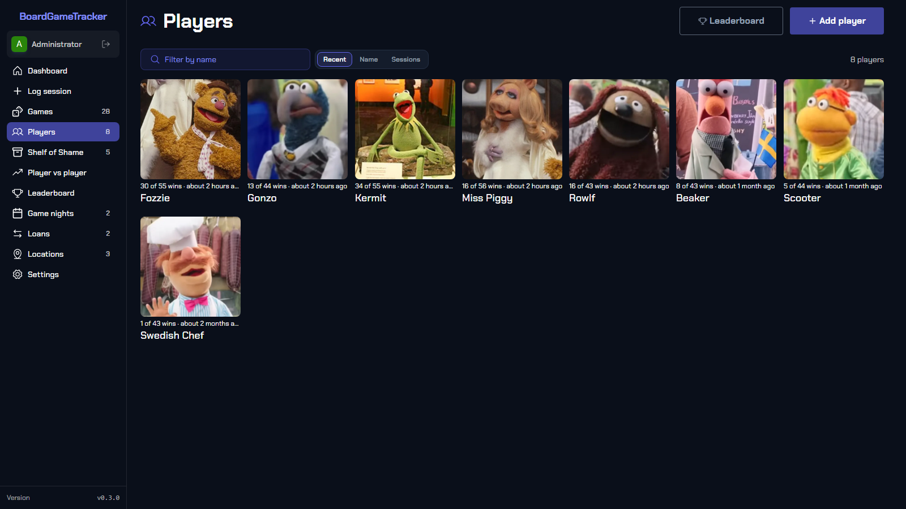

Players are the people you play with; they exist independently of user accounts. The overview shows each player as a tile with their win rate and number of sessions, most active players first; use the filter to find someone by name. Give a player an email address to send them game-night invitations.

A player page shows win rate, favourite games, play time, recent sessions, the games the player has on loan and the **badges** the player earned. Badges are awarded when a session is saved:

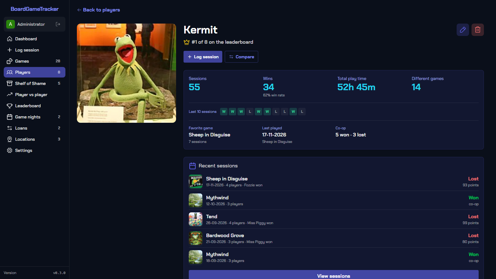

- One-off badges: *First Try* (win a game on the first play), *Photo Finish* (win by two points or less), *Almost there* (lose by two points or less), *Marathon Runner* (a session of four hours or more), *Learning Curve* (three improving scores in a row), *Monthly Goal* (20 sessions in a calendar month) and *Consistent Schedule* (a Saturday game ten weeks in a row).
- Tiered badges (green, blue, red, gold) count sessions, different games, wins, hours played, win percentage, solo sessions, winning streaks and different opponents.

## Shelf of Shame

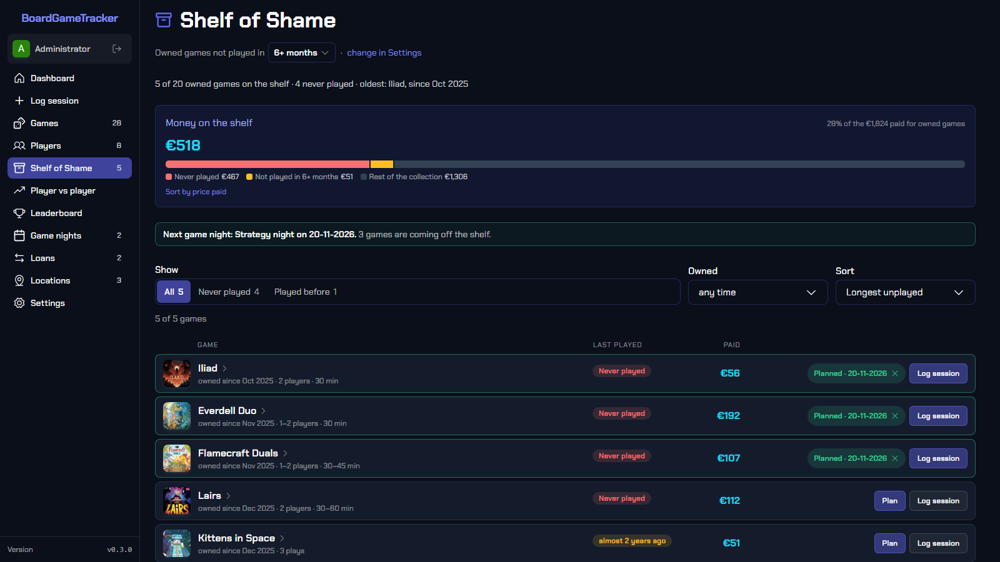

On by default. It lists owned games that have not been played in the configured number of months (games bought more recently than that are not shamed), with the money sitting on the shelf. Switch it off or change the threshold (6 months by default) under *Settings → Shelf of Shame*.

## Player vs player

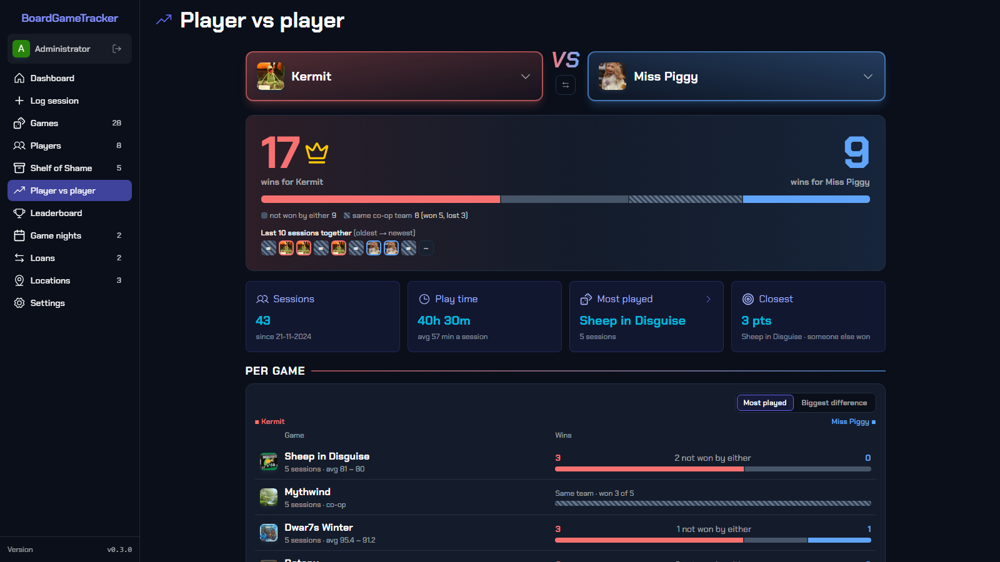

Pick two players to see how they do against each other; the page opens on the two players with the most games together, and the swap button exchanges the sides. The record counts every game they played together: wins for each player, games someone else won (a competitive game both players won counts for both) and co-op games on the same team, with the team's wins and losses. Co-op games never count as a win for one player against the other and don't break a winning streak. Below it are the last ten results with the current winning streak, the time spent together, the most played game and the closest finish, a per-game list with wins, average scores and the last result (sorted by most played or biggest lead), each player's best and worst games (games played together at least three times), the recent games together, and both players' overall stats in a collapsed table.

## Leaderboard

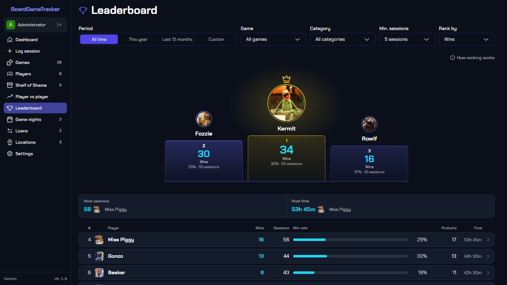

Ranks every player with at least one session by wins, then win rate, then number of plays; players with the same record share a rank. The table also shows podiums (top three finishes in scoring sessions of four or more players) and time played. The highlight cards above it name the player with the most wins, the most plays, the most time at the table and the best win rate; the win rate only counts players with at least five plays.

## Rules chat

When the [rules assistant](/BoardGameTracker/getting-started/rag/) is enabled, upload PDF rulebooks on a game page under *Manuals*. They are indexed in the background, and each manual shows its status (*Pending*, *Indexing*, *Indexed* or *Failed*); use *Re-index* when indexing failed.

Open *Rules chat* in the sidebar (or *Ask the manual* on a game page), pick a game or *All manuals* and ask. Answers cite the pages they come from. Readers do not see the chat.

## Game nights

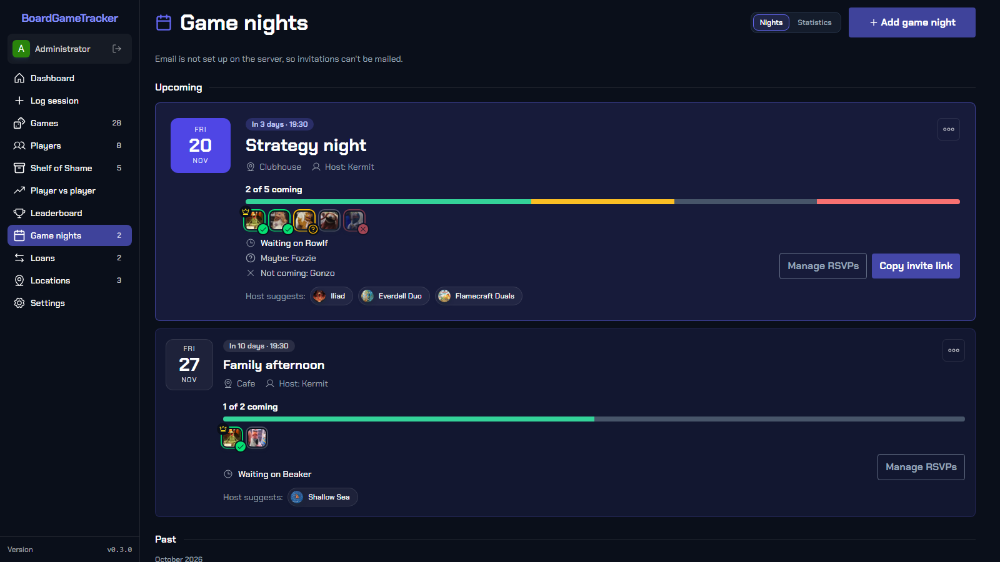

On by default; switch it off under *Settings → Game nights*. A game night has a host, a date and time, a location, suggested games and invited players; the location is picked from the ones under *Locations*.

The page is split into **Upcoming** and **Past**. Each upcoming night is a card with the date, how far away it is (*Tomorrow · 19:30*), the location, the host, the games the host suggests, the notes and a bar showing how many players are coming, maybe, have not answered or are not coming. From the card you can *Copy invite link*, *Email invites*, edit or delete the night.

*Email invites* mails the RSVP link to every invitee who has not answered yet and has an email address, at most 50 per send. It first lists who gets one and who has no address, and only sends after you confirm. A night can be emailed once every 10 minutes. The button stays disabled, with the reason, while email or the public URL is not set up. Past nights are a short list; open one to see who attended.

Before a night opens, its page shows the plan: when it starts, the RSVPs with *Manage RSVPs*, and the planned games. Each planned game shows where it is stored, and games stored at another location than the night's are marked *Bring along*. Starting, logging and finishing games and *End night* become available 12 hours before the start time. The RSVPs stay on the page until the night is over.

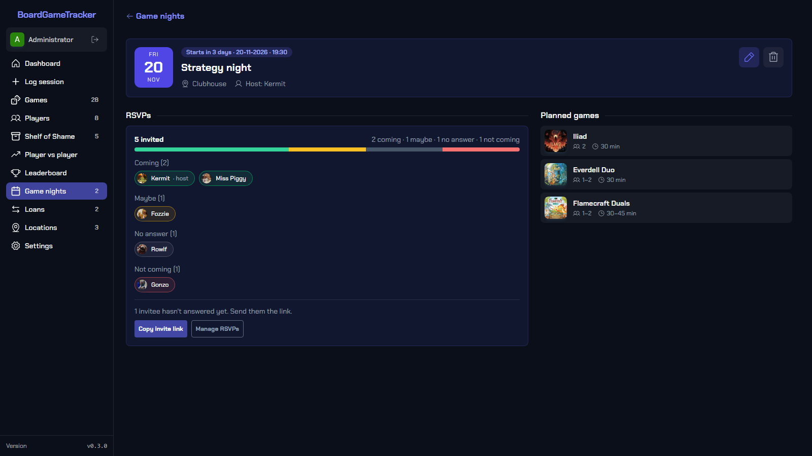

### Managing RSVPs

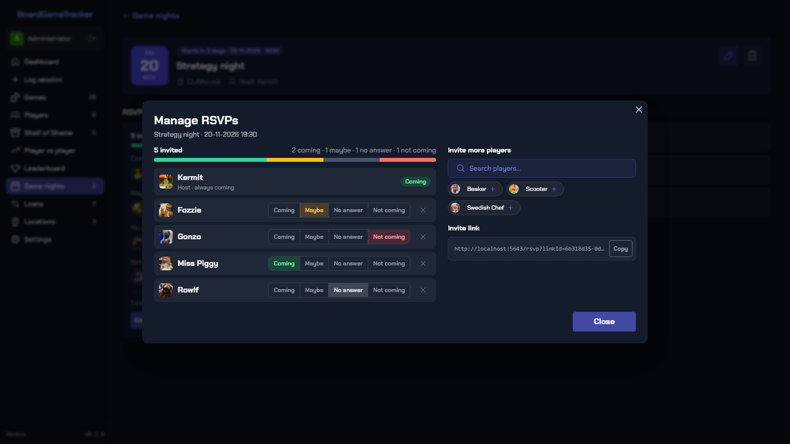

*Manage RSVPs* on a card lists every invited player with a *Coming* / *Maybe* / *No answer* / *Not coming* switch, so you can record answers you got by message or in person. The host is always coming. Use × to remove a player from the night, *Invite more players* to add someone, and copy the invite link from the same dialog. Hosts can still change answers after the night has taken place.

### The invite link

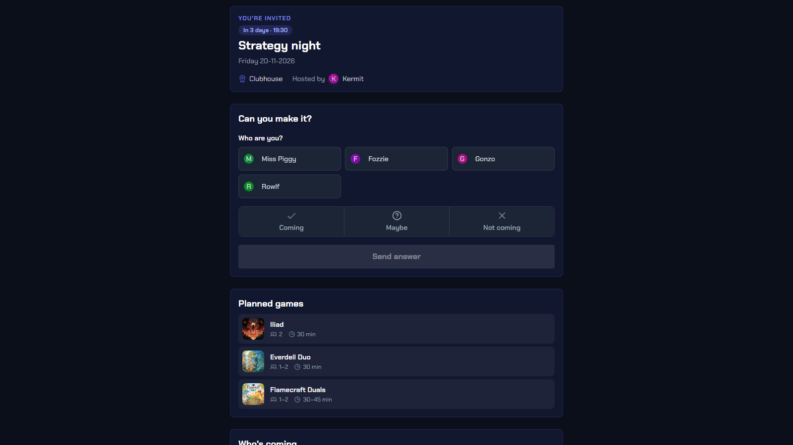

Every game night has a public invite link that players open without an account. The page shows the date, location, host and notes, who is coming (grouped into *Coming*, *Maybe*, *No answer* and *Not coming*), the games you might play and their rulebooks. To answer, a player picks their name under *Who are you?*, chooses *Coming*, *Maybe* or *Not coming* and presses *Send answer*. The host sees *Maybe* apart from players who haven't answered, and only *Coming* counts as attending. *Change answer* lets them pick again. A signed-in user linked to an invited player finds that player already picked. The link keeps accepting answers while the night is in progress and stops once the night has ended or is 12 hours past its start.

When email is configured and the host's player has an email address, the host gets a mail when someone answers (at most one per invitee every five minutes; the host's own answer is not mailed). Turn on *Require authentication for RSVPs* if the link should only work for signed-in users. The invite link and the invitation emails use the **Public URL** setting under *Settings → General*, so set that to the address your players use. Invitations are not sent while it is empty.

## Loans

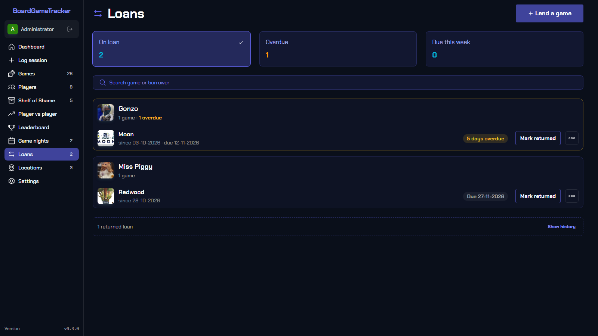

Track which game is lent to whom. The cards at the top count the games on loan, overdue, due this week and returned.

*Lend a game* asks for the game, the borrower (or creates a new player), the start of the loan and when it should come back: in *1 week*, *2 weeks* or *1 month*, *No due date* to keep it open until it is returned, or *Pick date* for a return-by date of your own. A game can't be lent twice in the same period; a loan without a return keeps the game blocked, even when it is overdue.

Active loans are listed with the soonest due date first. Each row shows how the loan stands — *3 days overdue* in red, *Due today* or *Due in 4 days* in amber, otherwise the due date or *No due date*. Press *Mark returned* when the game comes back and enter the return date. Returned loans are folded away under *Show history*, where they can still be edited or deleted. A game that is out on loan shows it on its game page.

## Storage

Where your games are kept. Storage starts at a location (see below), such as *Home* or *Trailer*; under it you add storage locations as deep as you like: a room, a cabinet, a box. A storage location is *Free* (you add what is inside yourself), *Shelves* (a number of shelves) or *Grid* (rows and columns, like a Kallax). Shelves and grid cells can be renamed, and a cabinet can be made bigger or smaller later; games on a removed shelf or cell move to the cabinet itself.

A game or expansion is stored directly in a location (*Somewhere in Home*) or in any storage location below it. Only owned games and games for trade get a place; another state clears it. An expansion stays in its base game's box until you give it a place of its own, in the *Expansions* dialog or its quick view. A loaned game keeps its place and is greyed out.

The *Storage* page shows every location and storage location in a tree. A cabinet is drawn with the covers on its shelves or in its cells: drag a box to reorder it or move it to another shelf, or select it to turn it (front, on its side, flat), move it or open the game. Search with *Where is…?* to jump to a game or expansion. *Needs a place* lists owned games without a place; tick some and move them in one go. Moving a storage location takes everything inside along. Deleting one moves its games one level up and deletes the shelves and storage locations inside it.

You can also pick a storage location on a game's edit page and in the games table; where you pick one you can create a new location or storage location on the spot.

## Locations

The places you play, such as your living room, a friend's house or the local game café. A session can be linked to a location, and a game night needs one. Each location is a tile with its number of sessions and the number of games stored there; filter them by name.

Open a location to see the sessions, games and players played there and the total play time, followed by its sessions, newest first, with the winners and duration (*Show all* lists every session). A *Storage* card lists its storage locations and how many games are stored in each; a location where you never played shows its storage first. Edit and delete the location from this page; deleting it also deletes its storage locations, and its games lose their storage location. A location that a session or a game night still uses cannot be deleted: the page says what is linked to it, so move those to another location first.

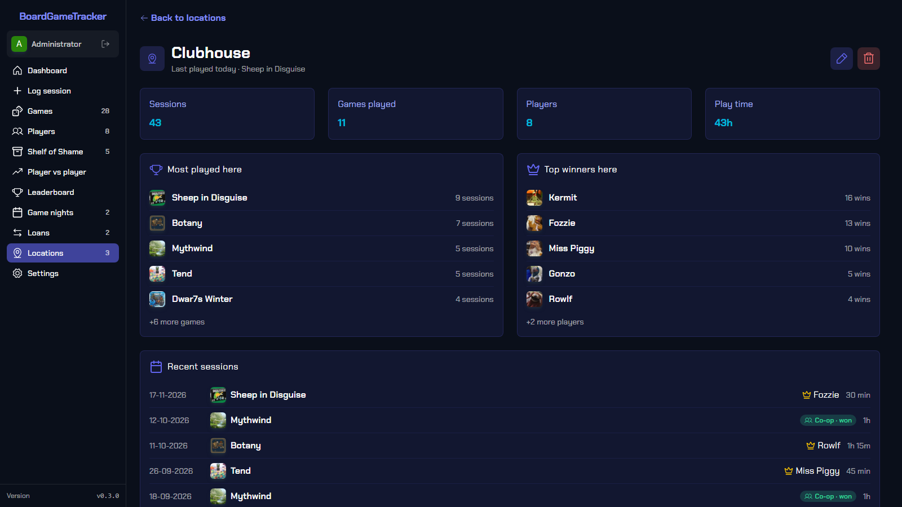

## Settings

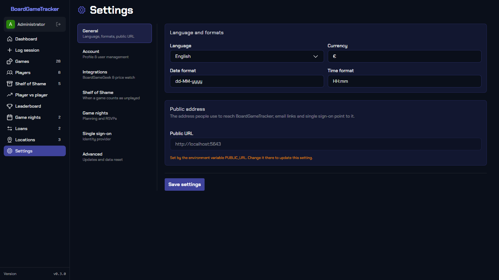

- **General** — language, date and time format, currency and the Public URL.
- **Account** — your profile, password and linked player; admins also manage users here.
- **Integrations** — the BoardGameGeek API key used for imports, and the base URL and API key of the changedetection.io instance used for [price tracking](#price-tracking). *Test connection* checks a key and shows the status (*Connected*, *Rejected*, *Unreachable*, *Rate limited* or *Not configured*).
- **Shelf of Shame**, **Game nights** — the feature toggles described above.
- **Single sign-on** — the OpenID Connect provider; see [Authentication and users](/BoardGameTracker/getting-started/authentication/).
- **Advanced** — update checks and the stable/beta track, links to report bugs and translate, and the danger zone. *Reset data* removes games, sessions, players, locations, loans, game nights, badges and uploaded images, and keeps settings and accounts. *Factory reset* also removes users and settings and recreates `admin` (password from `ADMIN_PASSWORD`, else `admin`).

Users and Readers only see *Account*. With `AUTH_ENABLED=false` there is no *Account* or *Single sign-on*.

Settings that are forced through an environment variable are shown greyed out with a note naming the variable.
